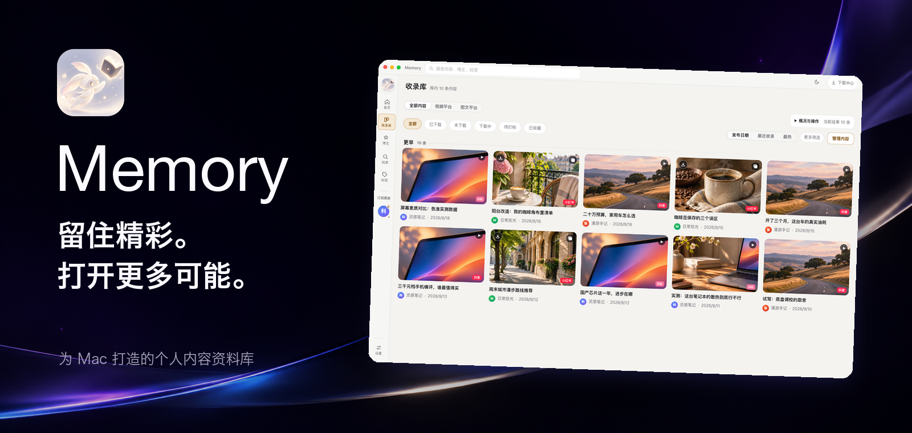
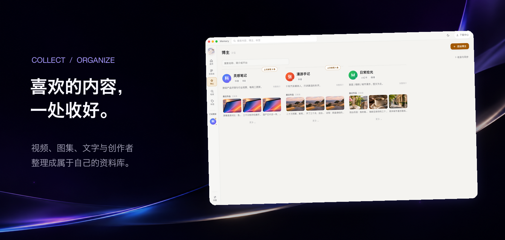
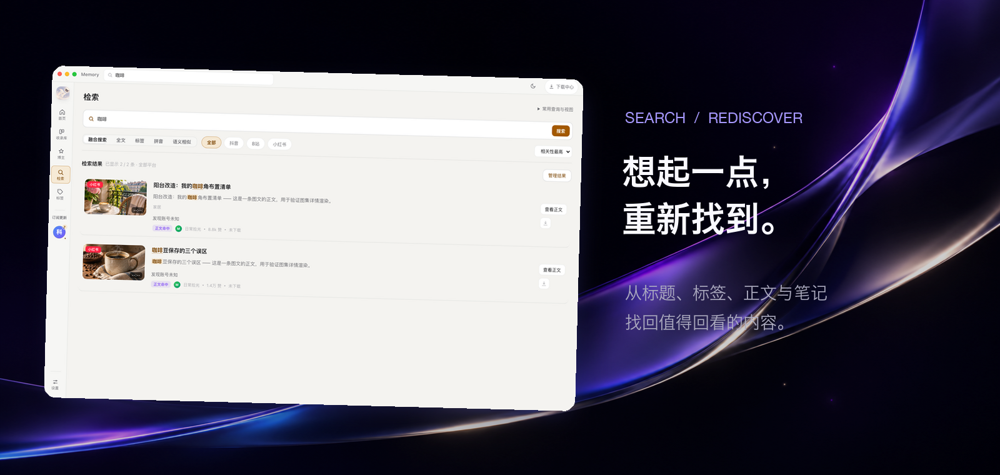

# Memory

**为你珍藏的内容，留一个随时可以回来的地方。**

视频、图集、文字，和那些值得一直关注的创作者。 
收好、整理、找回，再一次发现喜欢的理由。

[下载与更新](https://github.com/ailble-abum/Memory-releases/releases)　·　[功能亮点](#为喜欢的内容而设计)　·　[反馈与建议](https://github.com/ailble-abum/Memory-releases/issues)

---

## 为喜欢的内容而设计

### 喜欢的，都有归处

把想留住的内容和创作者收进一个地方，按来源、账号和作品浏览。零散的收藏，也能慢慢变成清晰的资料库。

### 一闪念，也能找回来

从标题、标签、已保存的正文、字幕或笔记开始搜索。无论是想再看一遍，还是想找回当时的灵感，都有迹可循。

### 不止收藏

- **自在回看**：视频、图集与文字，按照喜欢的方式浏览。
- **随手整理**：标签与笔记，让内容和自己的想法留在一起。
- **听见更多**：通过字幕转写，为声音留下可以查找的文字。
- **安心保存**：备份与恢复，让珍贵的资料更容易保留和迁移。

### 让收藏，开始回应你

未来，我们希望 AI 博主能理解已保存的作品与资料，形成可调整的人设，在对话中记住你们的互动。你也可以补充资料、提出要求，让交流逐渐成长。

**未来探索，尚未上线。**

## 开始体验

Mac 测试版正在准备中。安装包和更新会发布在 [Releases](https://github.com/ailble-abum/Memory-releases/releases)；欢迎在 [Issues](https://github.com/ailble-abum/Memory-releases/issues) 分享建议或反馈问题。

图片中的名称与内容均为演示素材。部分功能的可用性受设备、网络及内容来源影响。

---

Memory · 留住精彩，打开更多可能。

